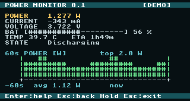

# Zero Watt

Cardputer Zero 的电池功率监视器。每秒读取 BQ27220 的电压、电流、电量和温度，显示带符号的充/放电功率、净平均值、60 秒实时曲线，以及可平移缩放的历史页。



## 安装

把构建出的 `dist/ZeroWatt_0.1.0_rev1_arm64.deb` 复制到设备，然后安装：

```sh
sudo dpkg -i ZeroWatt_0.1.0_rev1_arm64.deb
systemctl --user daemon-reload
systemctl --user restart APPLaunch.service
```

采集器是用户级服务（`zero-watt-collector.service`）：首次启动时应用把 `/usr/share/zero-watt/zero-watt-collector.service` 复制到 `~/.config/systemd/user/`，再按需启动，不设开机自启。`zero-watt --status` 可查看采样状态。

## 操作

| 键 | 作用 |
|---|---|
| B | 切换后台常驻，设置自动保存 |
| T | 修改历史保留时长（1–1440 分钟，默认 30） |
| G | 全屏历史页；左右平移、上下缩放，Enter 跟随最新 |
| H | 帮助 |
| 短按 Esc | 返回 |
| 长按 Esc | 常驻开：关闭界面继续采样；常驻关：停止采集并退出 |

## 数据

- 读取 `/sys/class/power_supply/bq27220-0/` 下的 `voltage_now`、`current_now`、`capacity`、`temp`、`time_to_empty_now`、`status`。
- 功率 = 电压 × 电流，正为充电、负为放电。这是电池端功率，不是整机输入功率。
- 读不到的值显示 `--` 或 `?`；缺样本会在曲线上断开，不会补零。
- 历史保存在内存，重启采集服务或设备后清空；设置保存在 `~/.config/zero-watt/settings`。

## 构建

需要 CMake ≥3.31、Ninja、SDL2（桌面）和 C++17 编译器；首次配置会下载 LVGL 9.5。

```sh
cmake --preset darwin-arm64   # Linux 用 linux-x86-64
cmake --build --preset darwin-arm64-rel
ctest --test-dir build/darwin-arm64 -C Release --output-on-failure
./build/darwin-arm64/Release/zero-watt --demo
```

交叉编译并打包 Debian 包（需要 `aarch64-linux-gnu-gcc/g++` 和 `dpkg`；首次会下载约 435 MB 的 BSP）：

```sh
cmake --workflow --preset cp0-cross-package
```

产物是 `dist/ZeroWatt_0.1.0_rev1_arm64.deb`。测试时可用 `--sysfs-root DIR` 指向模拟的 sysfs 目录。

## 限制

面向 Cardputer Zero：BQ27220 电池、320×170 屏幕、Linux/AArch64。实体按键、从启动器选择应用的完整流程、24 小时 soak 和程序自身功耗尚未验证。

## 许可

MIT。构建与打包流程参考 [CardputerZero Template](https://github.com/CardputerZero/Template)，[LVGL v9.5.0](https://github.com/lvgl/lvgl/tree/v9.5.0) 提供界面与字体。
